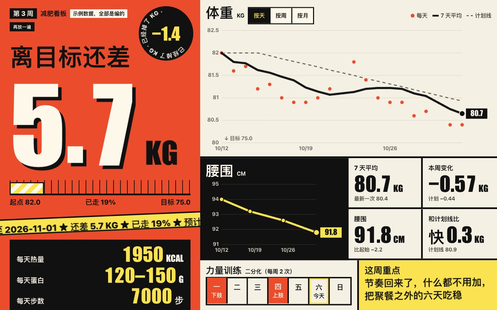

<!-- 改名时全文替换 3000IM/weight-loss-coach，再改 SKILL.md 开头的 name。 -->

# 减肥教练 weight-loss-coach

**在线试手势页（示例数据，要摄像头，用 Chrome）**：[电脑版](https://3000im.github.io/weight-loss-coach/) · [手机版](https://3000im.github.io/weight-loss-coach/mobile.html)

一个给 Agent 用的 skill：第一次问答给你定计划，每天问你体重，每周按真实数据调下周的饮食和运动，你说「今天吃多了」它会算账告诉你是不是真吃多了。



上图是专属页（看板），数据是编的示例。

**English.** weight-loss-coach is an agent skill (Claude Code, Codex, or any agent that can read files and run commands) that acts as a weight-loss coach. It interviews you once to set calorie and protein targets, records your daily weight and waist, reviews each week against your 7-day average and adjusts next week's plan, and keeps a local dashboard with day, week and month views. Everything is stored as Markdown files on your own computer and the scripts use only the Python 3.9+ standard library. The conversation is in Chinese. Install: `git clone https://github.com/3000IM/weight-loss-coach.git ~/.claude/skills/weight-loss-coach` (Claude Code) or `~/.agents/skills/weight-loss-coach` (Codex), then say 「开始减肥计划」 in a new session. Not medical advice.

它做这些事：

1. **定计划**：它对你一无所知，一轮一轮问身高、体重、腰围、目标、运动习惯、吃饭场景和力量训练怎么分化（不懂就讲给你听，让你选），算出每天热量和蛋白、每周该掉多少、哪天到，并算清这笔账。
2. **每天记**：你报体重和腰围，它记下来给一句判断。也能一次补录好几天。
3. **每周复盘**：掉快了慢了都调下周计划，原因列两三个并标证据强弱。
4. **像教练一样答**：「今天吃多了」「体重怎么涨了」，它先看你的数据再回答。
5. **拍照估值（beta）**：发饭菜照片估个数。AI 判断不准，只让你有点数。
6. **主动提醒**：每天定时弹通知问体重，今天记过就不弹。
7. **专属页**：问答一结束就给你开一张本地网页，当天就能看。像记账软件一样按天、按周、按月切换，从开始到现在都有。

需要一个能读写本机文件、能跑命令的 Agent，电脑上有 Python 3.9 以上（Mac 和 Windows 都行，不用装任何依赖）。

## 怎么装

两种装法选一种：自己在终端跑一行命令，或者把一句话发给你的 Agent 让它装。装好后都要开一个新会话。

### Claude Code

终端里跑：

```
git clone https://github.com/3000IM/weight-loss-coach.git ~/.claude/skills/weight-loss-coach
```

或者发给 Agent：

```
把 https://github.com/3000IM/weight-loss-coach 克隆到 ~/.claude/skills/weight-loss-coach/，然后告诉我装好了
```

Windows 上目录是 `C:\Users\<你的用户名>\.claude\skills\weight-loss-coach\`。不会用 git 的话，在 GitHub 页面点 Code → Download ZIP，解压后把整个文件夹放到这个位置，文件夹名改成 `weight-loss-coach`。

### Codex

终端里跑：

```
git clone https://github.com/3000IM/weight-loss-coach.git ~/.agents/skills/weight-loss-coach
```

或者发给 Agent：

```
把 https://github.com/3000IM/weight-loss-coach 克隆到 ~/.agents/skills/weight-loss-coach/，然后告诉我装好了
```

Windows 上目录是 `C:\Users\<你的用户名>\.agents\skills\weight-loss-coach\`。装好后重开 Codex。

### 其他 Agent

```
把 https://github.com/3000IM/weight-loss-coach 克隆到你的 skill 目录，让你能读到里面的 SKILL.md，然后告诉我装好了
```

没有 skill 目录的 Agent，就让它每次先读这份 `SKILL.md`。

## 怎么开始

装好后对 Agent 说：

```
开始减肥计划
```

它问完问题就给你计划、打开专属页，再问你每天几点提醒。之后每天说一句「体重 81.2，腰围 90」就行。

## 看板怎么开

问答一结束它会自动打开，之后每次记体重都会更新。想再看，跟 Agent 说「打开看板」，或者直接用浏览器打开用户主目录下的 `weight-loss-data/dashboard.html`。也可以在 skill 目录里自己跑：

```
python3 coach.py dashboard --open
```

想先看看长什么样，不用填数据：

```
python3 coach.py dashboard --data examples/three-weeks --open
```

`examples/three-weeks/` 是一份编的三周示例数据，上面那张截图就是它。

## 补录和演示

之前称过的数可以一次补进来，每行「日期 体重 腰围 备注」，逗号或空格隔开，腰围和备注可以空。直接发给 Agent 就行，或者自己跑：

```
python3 coach.py import 你的数据.csv
```

想演示记了一周的样子，走完问答后用自带的 7 天示例数据，日期会整体平移到以今天结尾：

```
python3 coach.py import examples/seven-days.csv --to-today
```

这些数是编的，会写进你的 `log.md`，盖掉同日期的记录，真实记录别这么用。

## 数据在哪

全部是你自己电脑上的 Markdown 文件，在用户主目录的 `weight-loss-data/`：

| 文件 | 内容 |
|---|---|
| `plan.md` | 你的信息、目标、本周计划、调整记录 |
| `log.md` | 每天的体重和腰围 |
| `reviews.md` | 每周复盘 |
| `meals.md` | 拍照估值 |
| `dashboard.html` | 专属页，每次记录后自动更新 |

你可以直接打开改。发照片和聊天内容时，这些内容会经过你用的 AI 服务，不想给人看的别发。

## 提醒

提醒靠系统自带的定时器（Mac 的 launchd、Windows 的任务计划程序），不调用模型，不花额度，Agent 不用开着。不想要就说「关掉提醒」。不能在本机跑命令的 Agent 装不了，每天自己打开说一句就行。

## 免责声明

AI 判断不准。热量和蛋白目标是公式算的起点，拍照估值只让你有点数。这不是医疗建议，不能代替医生和营养师。未满 18 岁、怀孕哺乳期、有慢性病、在用影响体重或血糖的药、有进食障碍史的人，先问医生再用。身体有任何不舒服，先去看医生。

## 手势页

还有一个发朋友圈用的花活：对着摄像头张开手，粒子吸到手心再炸开，聚成你自己的体重曲线，也可以双手并拢唰地拉开，捏住一根线沿线滑就能读数。跟 Agent 说「打开手势页」就行。没有记录时显示示例数据，记了第一条就换成你的。手势和设置见 [showcase/README.md](showcase/README.md)。
